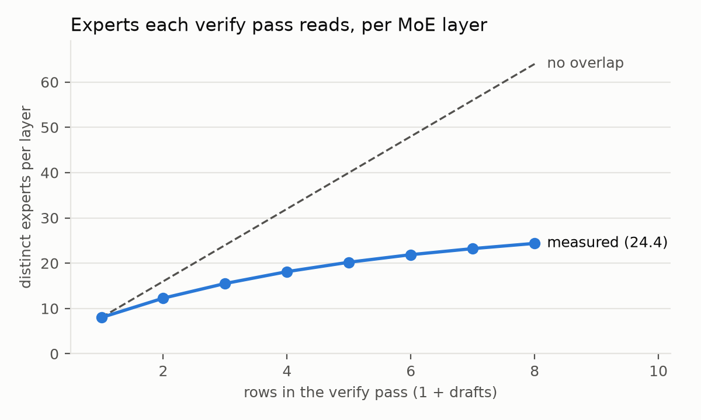
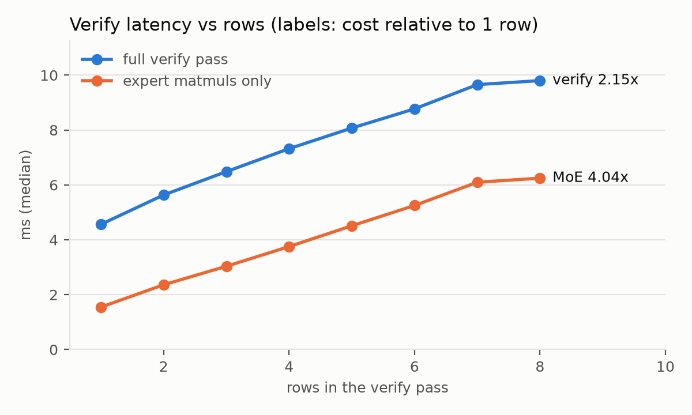
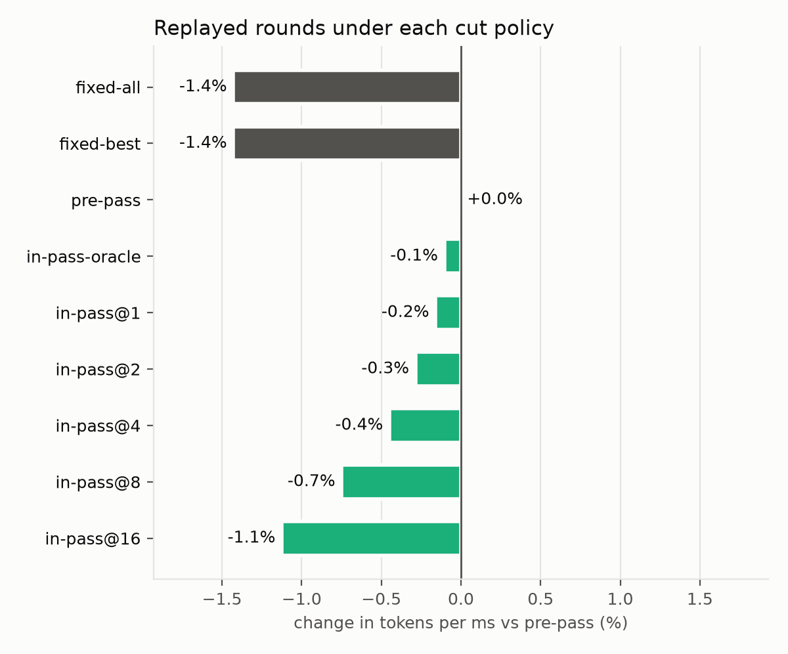

# Routing analysis

32 MoE layers, 40 experts, top-8, 1.64 MiB per expert; 1036 verify rounds.

## Go/no-go: **NO-GO**

Even perfect per-round routing beats pre-pass by only -0.1% (threshold 5%). Expert usage does not vary enough between rounds; take the fallback (cost model + pre-pass rule + kernels as a sync study).

## Acceptance

Mean accepted drafts per round: 2.97 of 7.

| draft position | P(accepted at least this many) |
|---|---|
| 1 | 0.78 |
| 2 | 0.58 |
| 3 | 0.48 |
| 4 | 0.38 |
| 5 | 0.30 |
| 6 | 0.25 |
| 7 | 0.22 |

Draft-probability calibration (predicted vs observed P(first i drafts accepted)):

| bin | n | predicted | observed |
|---|---|---|---|
| 0.0-0.2 | 2858 | 0.08 | 0.12 |
| 0.2-0.4 | 1321 | 0.30 | 0.36 |
| 0.4-0.6 | 938 | 0.49 | 0.54 |
| 0.6-0.8 | 742 | 0.70 | 0.69 |
| 0.8-1.0 | 1322 | 0.94 | 0.94 |

## Expert-union statistics

| rows | rounds | experts/layer | no-overlap | overlap ratio | total experts (mean ± sd) | CV across rounds | new experts this row | MiB read (unique) | MiB if repeats re-read | waste if re-read |
|---|---|---|---|---|---|---|---|---|---|---|
| 1 | 1036 | 8.0 | 8 | 1.00 | 256 ± 0 | 0.000 | 256.0 | 420 | 420 | 0% |
| 2 | 1036 | 12.3 | 16 | 0.77 | 393 ± 41 | 0.105 | 136.9 | 645 | 840 | 23% |
| 3 | 1032 | 15.5 | 24 | 0.65 | 497 ± 48 | 0.097 | 103.5 | 815 | 1260 | 35% |
| 4 | 1029 | 18.1 | 32 | 0.57 | 580 ± 49 | 0.085 | 83.9 | 952 | 1680 | 43% |
| 5 | 1026 | 20.2 | 40 | 0.51 | 647 ± 48 | 0.074 | 66.5 | 1061 | 2100 | 49% |
| 6 | 1022 | 21.9 | 48 | 0.46 | 700 ± 47 | 0.067 | 53.4 | 1149 | 2520 | 54% |
| 7 | 1020 | 23.2 | 56 | 0.41 | 743 ± 46 | 0.063 | 42.8 | 1219 | 2940 | 59% |
| 8 | 1016 | 24.4 | 64 | 0.38 | 780 ± 46 | 0.059 | 37.0 | 1280 | 3360 | 62% |

## Measured cost table

| rows | verify ms | vs 1 row | MoE ms | experts read | MiB unique | MoE GB/s |
|---|---|---|---|---|---|---|
| 1 | 4.56 | 1.00x | 1.55 | 256 | 420 | 285 |
| 2 | 5.63 | 1.23x | 2.36 | 406 | 666 | 296 |
| 3 | 6.48 | 1.42x | 3.03 | 519 | 852 | 294 |
| 4 | 7.32 | 1.60x | 3.75 | 607 | 996 | 278 |
| 5 | 8.07 | 1.77x | 4.51 | 665 | 1092 | 254 |
| 6 | 8.77 | 1.92x | 5.25 | 705 | 1157 | 231 |
| 7 | 9.66 | 2.12x | 6.10 | 750 | 1230 | 212 |
| 8 | 9.80 | 2.15x | 6.25 | 781 | 1282 | 215 |

Fit: verify_ms = 3.198 + 0.0035 x experts_read + 0.502 x rows (R^2 = 0.996).

Repeated expert ids (one layer; same number of row-expert pairs):

| rows | same experts ms | distinct experts ms | distinct unique | sorted path |
|---|---|---|---|---|
| 1 | 0.244 | 0.239 | 8 |  |
| 2 | 0.263 | 0.282 | 16 |  |
| 3 | 0.278 | 0.297 | 24 |  |
| 4 | 0.300 | 0.362 | 32 |  |
| 5 | 0.322 | 0.381 | 40 |  |
| 6 | 0.333 | 0.408 | 40 |  |
| 7 | 0.362 | 0.441 | 40 |  |
| 8 | 0.376 | 0.442 | 40 | yes |

If 'same' grows like 'distinct', repeated ids are re-read from memory; if 'same' stays flat, they are not.

## Cut policies on the logged rounds

Acceptance estimate: draft probabilities calibrated to observed acceptance (2-fold by prompt); held-out Brier score 0.109 vs 0.107 for raw draft probabilities.

| policy | tokens/ms | vs pre-pass | mean rows verified |
|---|---|---|---|
| fixed-all | 0.1423 | -1.4% | 7.93 |
| fixed-best | 0.1423 | -1.4% | 7.93 |
| pre-pass | 0.1443 | +0.0% | 7.07 |
| in-pass-oracle | 0.1442 | -0.1% | 7.08 |
| in-pass@1 | 0.1441 | -0.2% | 7.14 |
| in-pass@2 | 0.1439 | -0.3% | 7.18 |
| in-pass@4 | 0.1437 | -0.4% | 7.20 |
| in-pass@8 | 0.1433 | -0.7% | 7.29 |
| in-pass@16 | 0.1427 | -1.1% | 7.55 |

Does early routing predict later traffic? Correlation, across rounds, between the last row's new experts in the first l layers and in the remaining layers:

| l | correlation |
|---|---|
| 1 | 0.36 |
| 2 | 0.44 |
| 4 | 0.45 |
| 8 | 0.62 |
| 16 | 0.68 |

