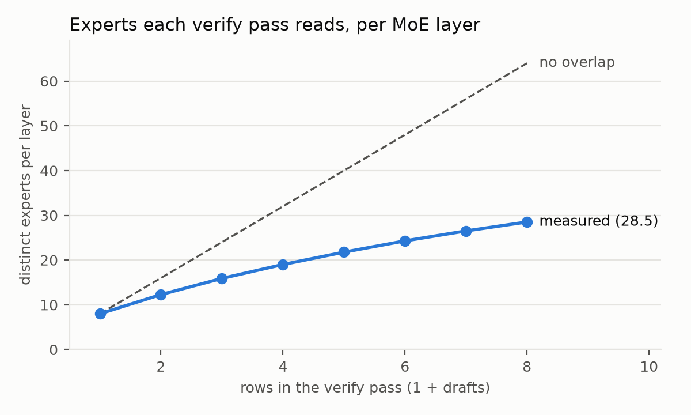
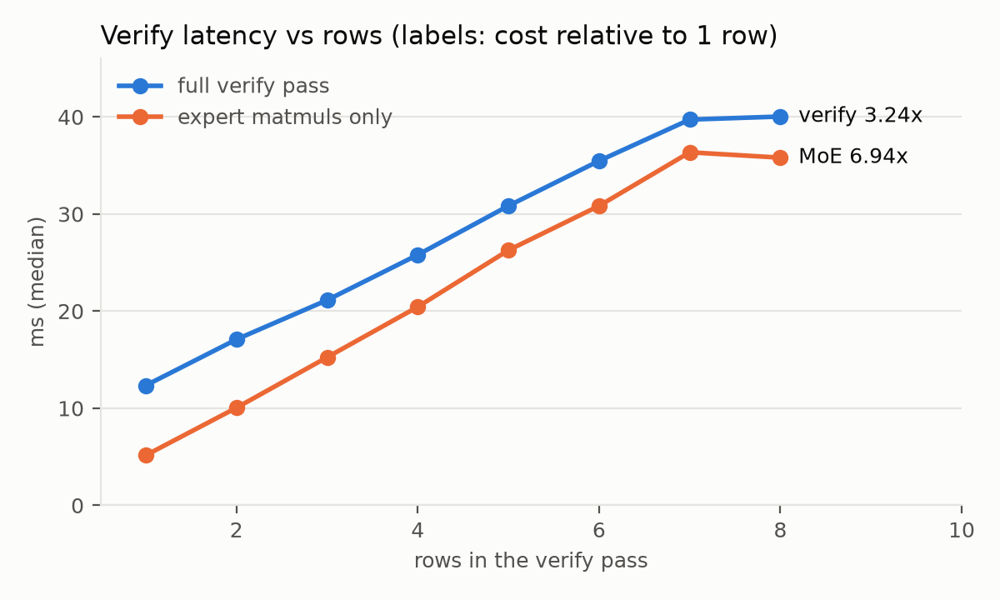
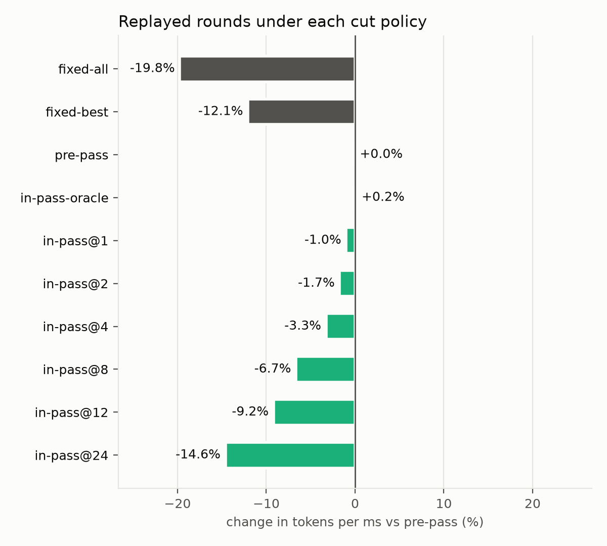

# Routing analysis

48 MoE layers, 128 experts, top-8, 2.53 MiB per expert; 1406 verify rounds.

## Go/no-go: **NO-GO**

Even perfect per-round routing beats pre-pass by only +0.2% (threshold 5%). Expert usage does not vary enough between rounds; take the fallback (cost model + pre-pass rule + kernels as a sync study).

## Acceptance

Mean accepted drafts per round: 1.92 of 7.

| draft position | P(accepted at least this many) |
|---|---|
| 1 | 0.63 |
| 2 | 0.42 |
| 3 | 0.29 |
| 4 | 0.21 |
| 5 | 0.16 |
| 6 | 0.12 |
| 7 | 0.09 |

Draft-probability calibration (predicted vs observed P(first i drafts accepted)):

| bin | n | predicted | observed |
|---|---|---|---|
| 0.0-0.2 | 4698 | 0.07 | 0.04 |
| 0.2-0.4 | 1798 | 0.29 | 0.22 |
| 0.4-0.6 | 1156 | 0.49 | 0.43 |
| 0.6-0.8 | 717 | 0.69 | 0.55 |
| 0.8-1.0 | 1348 | 0.94 | 0.90 |

## Expert-union statistics

| rows | rounds | experts/layer | no-overlap | overlap ratio | total experts (mean ± sd) | CV across rounds | new experts this row | MiB read (unique) | MiB if repeats re-read | waste if re-read |
|---|---|---|---|---|---|---|---|---|---|---|
| 1 | 1406 | 8.0 | 8 | 1.00 | 384 ± 0 | 0.000 | 384.0 | 972 | 972 | 0% |
| 2 | 1406 | 12.3 | 16 | 0.77 | 590 ± 52 | 0.088 | 205.6 | 1492 | 1944 | 23% |
| 3 | 1398 | 15.9 | 24 | 0.66 | 763 ± 79 | 0.103 | 173.5 | 1932 | 2916 | 34% |
| 4 | 1393 | 19.0 | 32 | 0.59 | 912 ± 98 | 0.108 | 149.2 | 2309 | 3888 | 41% |
| 5 | 1389 | 21.8 | 40 | 0.54 | 1045 ± 117 | 0.112 | 132.7 | 2645 | 4860 | 46% |
| 6 | 1383 | 24.3 | 48 | 0.51 | 1166 ± 132 | 0.114 | 120.6 | 2951 | 5832 | 49% |
| 7 | 1377 | 26.5 | 56 | 0.47 | 1273 ± 146 | 0.115 | 107.2 | 3221 | 6804 | 53% |
| 8 | 1371 | 28.5 | 64 | 0.45 | 1369 ± 158 | 0.116 | 96.0 | 3464 | 7776 | 55% |

## Measured cost table

| rows | verify ms | vs 1 row | MoE ms | experts read | MiB unique | MoE GB/s |
|---|---|---|---|---|---|---|
| 1 | 12.35 | 1.00x | 5.16 | 384 | 972 | 198 |
| 2 | 17.09 | 1.38x | 10.05 | 603 | 1526 | 159 |
| 3 | 21.14 | 1.71x | 15.25 | 793 | 2008 | 138 |
| 4 | 25.80 | 2.09x | 20.44 | 962 | 2436 | 125 |
| 5 | 30.85 | 2.50x | 26.27 | 1094 | 2769 | 111 |
| 6 | 35.48 | 2.87x | 30.84 | 1232 | 3117 | 106 |
| 7 | 39.73 | 3.22x | 36.36 | 1374 | 3478 | 100 |
| 8 | 40.04 | 3.24x | 35.81 | 1476 | 3737 | 109 |

Fit: verify_ms = 6.615 + 0.0066 x experts_read + 2.939 x rows (R^2 = 0.807).

Repeated expert ids (one layer; same number of row-expert pairs):

| rows | same experts ms | distinct experts ms | distinct unique | sorted path |
|---|---|---|---|---|
| 1 | 0.329 | 0.320 | 8 |  |
| 2 | 0.432 | 0.449 | 16 |  |
| 3 | 0.560 | 0.536 | 24 |  |
| 4 | 0.676 | 0.624 | 32 |  |
| 5 | 0.756 | 0.732 | 40 |  |
| 6 | 0.869 | 0.784 | 48 |  |
| 7 | 0.915 | 0.877 | 56 |  |
| 8 | 0.948 | 0.945 | 64 | yes |

If 'same' grows like 'distinct', repeated ids are re-read from memory; if 'same' stays flat, they are not.

## Cut policies on the logged rounds

Acceptance estimate: draft probabilities calibrated to observed acceptance (2-fold by prompt); held-out Brier score 0.140 vs 0.142 for raw draft probabilities.

| policy | tokens/ms | vs pre-pass | mean rows verified |
|---|---|---|---|
| fixed-all | 0.0540 | -19.8% | 7.91 |
| fixed-best | 0.0592 | -12.1% | 3.99 |
| pre-pass | 0.0673 | +0.0% | 3.94 |
| in-pass-oracle | 0.0675 | +0.2% | 3.94 |
| in-pass@1 | 0.0666 | -1.0% | 3.73 |
| in-pass@2 | 0.0661 | -1.7% | 3.84 |
| in-pass@4 | 0.0651 | -3.3% | 4.01 |
| in-pass@8 | 0.0628 | -6.7% | 4.29 |
| in-pass@12 | 0.0611 | -9.2% | 4.52 |
| in-pass@24 | 0.0575 | -14.6% | 5.25 |

Does early routing predict later traffic? Correlation, across rounds, between the last row's new experts in the first l layers and in the remaining layers:

| l | correlation |
|---|---|
| 1 | 0.42 |
| 2 | 0.50 |
| 4 | 0.63 |
| 8 | 0.73 |
| 12 | 0.77 |
| 24 | 0.80 |

